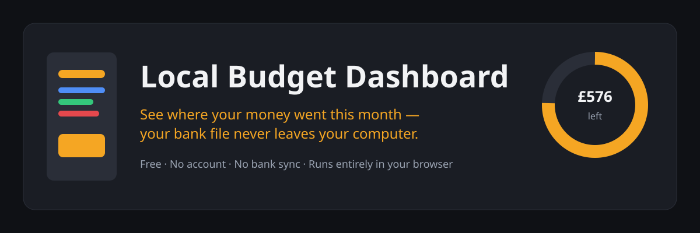
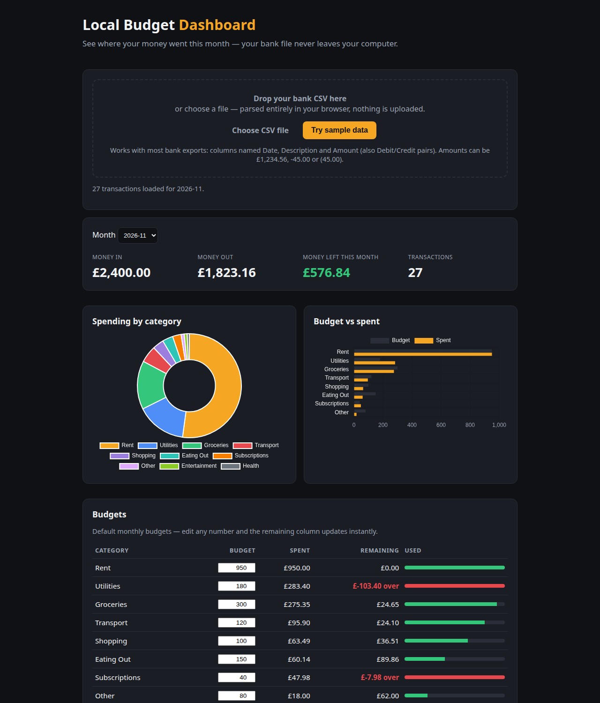
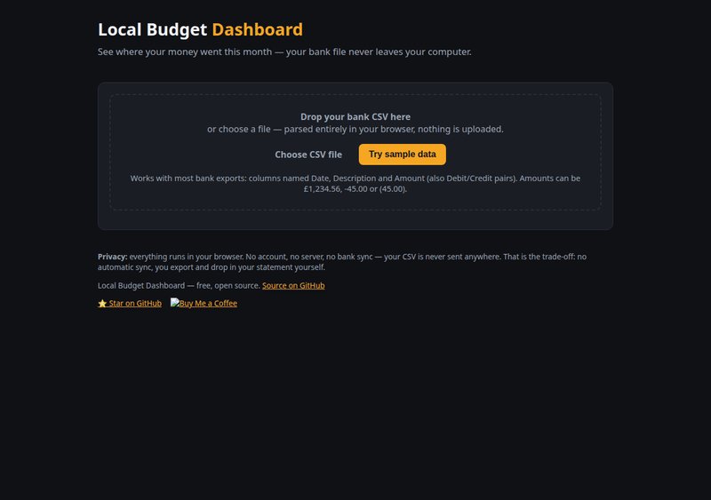

[](https://github.com/mrabr381/local-budget-dashboard)
[](https://www.buymeacoffee.com/muhammadabubakar)

# Local Budget Dashboard

> See where your money went this month — your bank file never leaves your computer.





**Live demo:** https://mrabr381.github.io/local-budget-dashboard/

## What it does

Drop in a bank statement CSV and instantly see:

- spending by category (chart + table)
- a budget per category, with what's left
- money left this month (income minus spending)

No account, no server, no build step. Open `index.html` and it works.

## Use it

1. Export a CSV from your bank (most banks offer "Download CSV").
2. Open the demo link above, or open `index.html` locally.
3. Drop the CSV in, or click **Try sample data** to see a demo month.
4. Pick the month from the dropdown. Edit any budget number in place.

## CSV shapes it understands

- Columns named `Date`, `Description`, `Amount` — or common variants
  (`Transaction Date`, `Narrative`, `Merchant`, `Debit`/`Credit` pairs).
- Amounts like `-45.00`, `£1,234.56`, or `(45.00)`.
- Dates as `2026-11-01` or `01/11/2026`.

Unknown merchants land in **Other**. Categories are guessed from the
description (Tesco → Groceries, Netflix → Subscriptions, and so on) —
check the list before trusting it for tax or anything official.

## Honest limits

- **No bank sync.** That is the price of privacy: your file never leaves
  your computer, so you export and drop it in yourself each month.
- Categories are keyword guesses, not a bank feed. They will be wrong
  sometimes — the transactions table shows every guess.
- One month at a time; it does not track savings goals or investments.
- Charts need the internet once (Chart.js loads from a CDN). The parsing
  and maths all run offline.

## Why free?

The paid rival is YNAB $14.99/month or $109/year (34-day free trial, no
free plan). This does the core job — "where did my money go?" — for
nothing, on your own machine. It does not do YNAB's bank sync, mobile
app, or budgeting method. If you want those, YNAB is the honest choice.

## Run the tests

```sh
node --test
```

11 tests cover CSV parsing (including alternate header names), category
totals, budget-remaining maths, and money-left computation. They also
run in CI on every push (`.github/workflows/ci.yml`).

## Files

- `index.html` — the whole tool
- `js/budget.js` — CSV parsing, categorising, totals (shared with tests)
- `js/sample-data.js` — one realistic demo month
- `test/budget.test.js` — the test suite
- `assets/hero.svg` — banner
- `assets/screenshot.png` — dashboard after loading sample data
- `assets/demo.gif` — short demo of loading the sample month

## License

MIT. Your data stays yours — there is nothing here that could take it.
